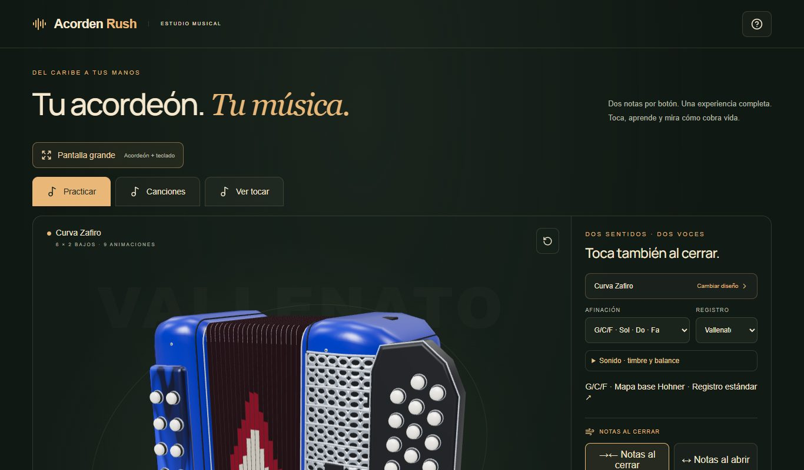

# Vallenato Hero

Juego de ritmo en 3D sobre un **acordeón diatónico vallenato** (bisonoro: cada botón suena distinto al cerrar y al abrir el fuelle). Inspirado en el formato de autopista de los juegos de ritmo, con arte, música y personajes 100 % originales.

> **Estado:** en desarrollo. La base del proyecto, *AcordeonRush*, ya está reorganizada (hito H0). Lo que funciona hoy es el **Estudio libre**: acordeón 3D con 43 botones animados, fuelle, samples reales y 24 afinaciones. El juego (autopista, HUD, puntaje, errores y escenario) se construye en los hitos H1–H6 de [docs/PLAN.md](docs/PLAN.md).



## Requisitos

- Node.js 20 o superior y npm
- Git LFS (los modelos `.glb` y los archivos `.blend` están en LFS)
- Un navegador con WebGL 2 y Web Audio (Chrome, Edge o Firefox recientes)

## Instalar y ejecutar

```bash
git lfs install
git clone https://github.com/Jesussscy/AcordeonRush.git
cd AcordeonRush
git lfs pull
npm ci
npm run dev
```

Abre la URL que indique Vite (por defecto http://localhost:5173).

| Comando | Qué hace |
|---|---|
| `npm run dev` | Servidor de desarrollo |
| `npm run build` | Typecheck y build de producción en `dist/` |
| `npm run preview` | Sirve el build de producción |
| `npm test` | Tests (Vitest): teclado, catálogo, 8 modelos 3D y transporte musical |
| `npm run typecheck` | Solo TypeScript |
| `npm run format` | Formatea el código con Prettier |

## Controles del Estudio libre

- **Botones de melodía:** `Q…P` (hilera 1), `A…Ñ Z` (hilera 2), `X…´` (hilera 3). Los bajos van en `1…0 - =`.
- **Fuelle:** `Espacio` = abrir; `Shift+Espacio` = cerrar. Con los botones de la interfaz se elige la dirección de reposo.
- Se puede tocar con el ratón o con el dedo sobre los pads o sobre los botones del modelo 3D.

Los controles del juego (Espacio mantenido = cerrar, hileras Z/A/Q, Enter = Parranda, Esc = pausa) llegan en el H1.

## Agregar canciones

*(Disponible a partir del H1.)* Crea una carpeta `songs/<nombre>/` con un `chart.json` (o un `.mid`) y, si quieres, `audio.mp3` y `cover.jpg`. Aparecerá en el menú sin tocar código. Las carpetas `songs/_<nombre>/` son privadas: el juego las ve, pero git las ignora. El formato está en [.claude/skills/chart-authoring/SKILL.md](.claude/skills/chart-authoring/SKILL.md).

## Estructura

| Carpeta | Contenido |
|---|---|
| `src/` | Código: `core/`, `instrument/`, `audio/`, `gameplay/`, `input/`, `ui/studio/` (y, más adelante, `render/`, `hud/` y `stage/`) |
| `assets/` | Archivos servidos tal cual (`publicDir` de Vite): modelos GLB, samples de audio, favicon |
| `data/layouts/` | Mapa de notas del acordeón (G/C/F, tabla Hohner de 31 botones) |
| `songs/` | Canciones (una carpeta por canción) |
| `art/` | Fuentes de arte que no se usan en el juego: archivos Blender, renders, banco de audio original |
| `tools/` | Scripts de Blender (`tools/blender/`) y de audio (`tools/audio/`) |
| `tests/` | Tests automatizados |
| `docs/` | [Análisis](docs/ANALISIS.md), [plan](docs/PLAN.md), capturas e historial |

## Licencias y créditos

- **Código:** [MIT](LICENSE).
- **Modelos 3D y arte original:** © Jesussscy, todos los derechos reservados ([assets/models/LICENSE.md](assets/models/LICENSE.md)).
- **Samples de acordeón:** *Button Accordion HN* de [FreePats](https://freepats.zenvoid.org/), CC0-1.0. Grabado por Jeff Stauffer; banco procesado por michael02022.
- **Mapa de notas:** basado en la tabla de digitación Hohner G/C/F de 31 botones.

El proyecto no incluye grabaciones comerciales.
