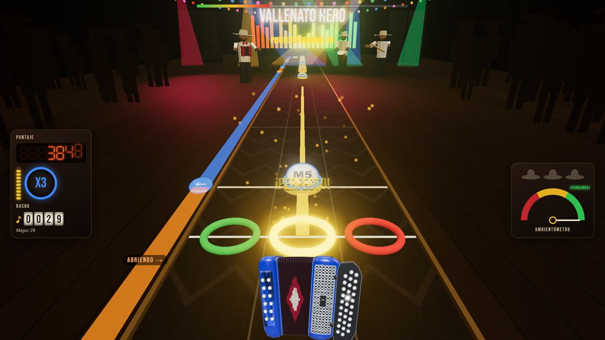
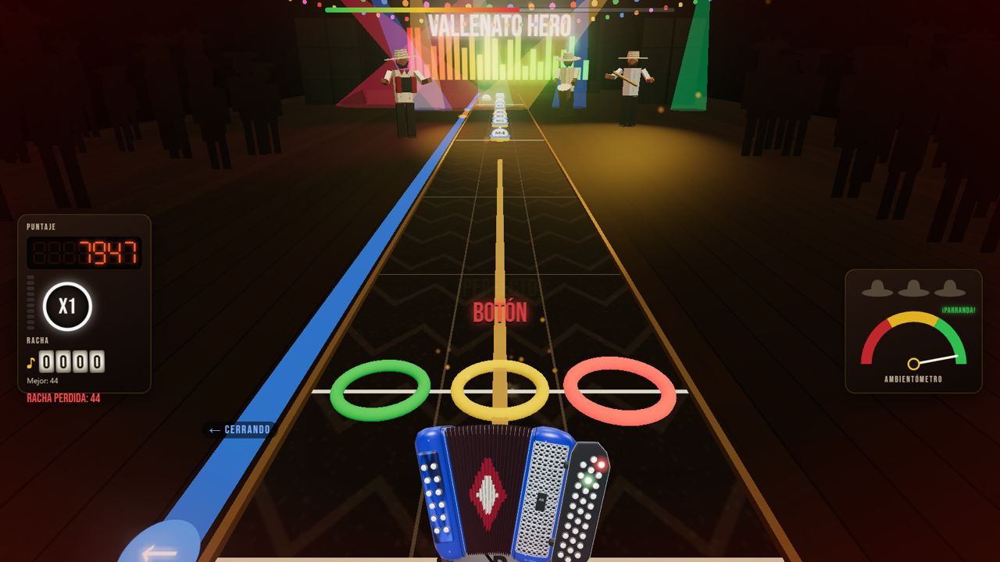
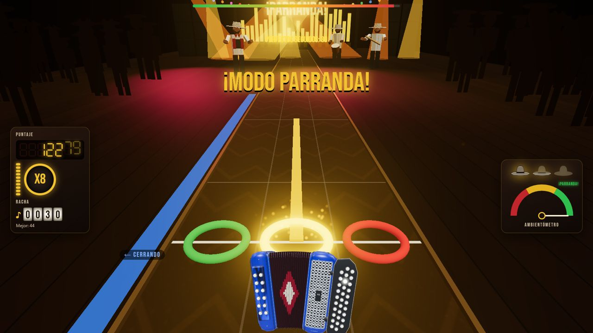
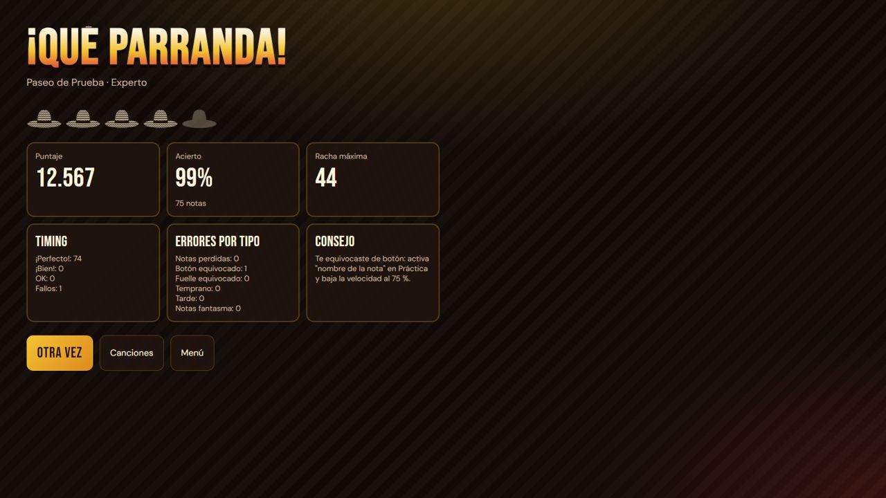

# Vallenato Hero

Juego de ritmo en 3D sobre un **acordeón diatónico vallenato**. El acordeón es bisonoro: cada botón suena una nota al **cerrar** el fuelle y otra al **abrir**. Los botones son los "trastes" y el fuelle es el "rasgueo". Las gemas bajan por una autopista de tres carriles, uno por cada hilera del acordeón, sobre una tarima de caseta con músicos, luces y público.

Inspirado en el formato de autopista de los juegos de ritmo. El arte, la música, los personajes y el HUD son 100 % originales.



| Fallo de botón | Modo Parranda | Resultados |
|---|---|---|
|  |  |  |

## Requisitos

- Node.js 22.18+ (probado con 24) y npm
- Git LFS: los modelos `.glb` y los archivos `.blend` están en LFS
- Navegador con WebGL 2 y Web Audio: Chrome, Edge o Firefox recientes

## Instalar y jugar

```bash
git lfs install
git clone https://github.com/Jesussscy/AcordeonRush.git
cd AcordeonRush
git lfs pull
npm ci
npm run dev
```

Abre la URL que indique Vite (por defecto http://localhost:5173). Luego elige **Jugar** → canción → dificultad → tu acordeón → **¡A tocar!**

## Controles (configurables en Ajustes)

| Acción | Tecla |
|---|---|
| Hilera de afuera (Sol, verde) | `Z X C V B N M , . -` |
| Hilera del medio (Do, amarillo) | `A S D F G H J K L Ñ ´` |
| Hilera de adentro (Fa, rojo) | `Q W E R T Y U I O P` |
| Fuelle | mantener `Espacio` = **cerrar** (←, azul) · soltar = **abrir** (→, naranja) |
| Modo Parranda | `Enter`, o sacudir el fuelle 4 veces rápido |
| Pausa | `Esc` |

- **Cómo se toca una nota.** Cada gema muestra el botón (`M5` = hilera del medio, botón 5), la tecla y una flecha con el sentido del fuelle. Cuenta solo si el botón y el fuelle son correctos en ese instante.
- **El fuelle como rasgueo.** Puedes tener el botón presionado y cambiar el fuelle justo a tiempo.
- **Fuelle equivocado.** Suena la *otra* nota del botón, como en un acordeón real.
- **Franja lateral.** La franja de la izquierda anticipa los cambios de fuelle.
- **Controlador MIDI** (opcional): cada nota MIDI toca el botón que da esa nota, y el fuelle la sigue.

## Modos y dificultad

- **Dificultades.** Las cuatro se generan automáticamente a partir del chart completo:
  - **Fácil:** solo la hilera del medio y pocos cambios de fuelle. Los 2 primeros fallos no reinician el multiplicador.
  - **Medio:** hileras de afuera y del medio.
  - **Difícil:** las 3 hileras, sin las notas más rápidas.
  - **Experto:** el chart completo.
- **Práctica.** Velocidad del 50 al 100 %, bucle de una sección de 4 compases y nombre de la nota en cada gema. La partida no termina aunque el Ambientómetro llegue a cero.
- **Estudio libre.** Toca el acordeón 3D sin canción: 24 afinaciones, registros y modo "Ver tocar".
- **Calibración.** Mide la latencia de audio y de video con toques al pulso.
- **Ajustes.** Fuelle asistido (apagado por defecto), tecla en las gemas, volumen, calidad gráfica y reasignación de teclas.

## Puntaje, errores y desafine

- **Ventanas de tiempo y puntos.**

  | Calificación | Ventana | Puntos |
  |---|---|---|
  | ¡PERFECTO! | ±35 ms | 50 |
  | ¡BIEN! | ±70 ms | 35 |
  | OK | ±110 ms | 20 |

  Los puntos se multiplican por el multiplicador (x1 a x4; x8 en Parranda). Las notas sostenidas dan 25 puntos por beat.
- **Tipos de error.** Cada uno tiene su etiqueta flotante:
  - `¡FALLO!`: no tocaste la nota.
  - `BOTÓN`: botón equivocado. En el acordeón 3D se marca en rojo el botón que tocaste y en verde el correcto.
  - `¡FUELLE!`: fuelle equivocado. La flecha correcta parpadea; la nota cuenta como OK como máximo y rompe el multiplicador.
  - `TEMPRANO` / `TARDE`: tocaste fuera de tiempo.
  - Nota fantasma: tocaste sin que hubiera nota. Penalización leve.
- **Al fallar**:
  - la pista del acordeón **se desafina** (medido: −61 cents), ondula, se distorsiona y baja de volumen; al acertar se **recupera en unos 300 ms**;
  - suena una pifia (3 variantes), la cámara tiembla y aparece una viñeta roja;
  - la racha se atasca con un golpe seco y el público abuchea.
  - El acompañamiento nunca se detiene.
- **Pantalla de resultados.** Muestra:
  - de 1 a 5 sombreros vueltiaos;
  - porcentaje de acierto y racha máxima, con aviso de récord;
  - desglose por calificación y por tipo de error;
  - un consejo automático.
  - Los récords se guardan por canción y dificultad.

## Agregar canciones (sin tocar código)

Crea una carpeta en `songs/`:

```
songs/mi-cancion/
├── chart.json     # o un archivo .mid
├── audio.mp3      # opcional: pista grabada (es la que se desafina al fallar)
└── cover.jpg      # opcional
```

`chart.json` usa tiempos en **beats**:

```json
{
  "title": "Mi canción",
  "artist": "Yo",
  "bpm": 96,
  "offsetMs": 0,
  "layout": "gcf",
  "parrandaPhrases": [[16, 32]],
  "notes": [{ "t": 0, "pitch": "E4", "dur": 1 }, { "t": 1, "pitch": "G4", "dur": 0.5, "button": "M5", "bellows": "push" }]
}
```

- **Botón y fuelle.** El juego elige solo el botón y el sentido del fuelle de cada nota (prefiere la hilera del medio y pocos cambios de fuelle). Si quieres, puedes forzarlos con `button` y `bellows`.
- **Desde texto.** `node tools/text-to-chart.mjs songs/paseo-de-prueba/source.json --out songs/paseo-de-prueba/chart.json` convierte la notación `E4:1 G4:0.5 R:1 …`.
- **Desde MIDI.** `node tools/midi-to-chart.mjs cancion.mid --title "…" --out songs/<carpeta>/chart.json` hace la conversión. También puedes soltar el `.mid` directamente en la carpeta.
- **Canciones privadas.** Las carpetas `songs/_<nombre>/` aparecen en el juego, pero git no las sube.

Usa solo material original, CC0 o con permiso. La canción incluida, **"Paseo de Prueba"**, es una melodía original libre de derechos (96 BPM, Do mayor, forma A A B A B, con las frases B como frases Parranda). Más detalles en [.claude/skills/chart-authoring/SKILL.md](.claude/skills/chart-authoring/SKILL.md).

## Desarrollo

| Comando | Qué hace |
|---|---|
| `npm run dev` | Servidor de desarrollo |
| `npm run build` | Typecheck y build de producción en `dist/` |
| `npm run preview` | Sirve el build de producción |
| `npm test` | 46 tests unitarios (Vitest): charts, digitación, dificultades, juez, puntaje, MIDI, 8 modelos 3D y transporte |
| `npm run test:e2e` | 9 tests E2E (Playwright con el Chrome del sistema, ver abajo) |
| `npm run format` | Prettier |

Los tests E2E abren el juego real en Chrome y juegan con un bot que dispara eventos de teclado sobre el reloj de audio. Cubren:

- la demo perfecta en las 4 dificultades;
- la clasificación de errores;
- el desafine medido en Hz;
- 60 FPS a 1080p;
- la práctica con bucle;
- las canciones nuevas añadidas soltando una carpeta.

### Estructura

| Carpeta | Contenido |
|---|---|
| `src/core/` | Sesión de juego, reloj de audio, ajustes y récords |
| `src/gameplay/` | Charts, digitación (Viterbi), dificultades, juez, puntaje, armonía, MIDI y autopista |
| `src/instrument/` | Acordeón 3D: catálogo, rig de botones y fuelle, halos por botón |
| `src/audio/` | Sampler Hohner, acompañamiento de paseo, percusión, efectos, desafine y pista grabada |
| `src/render/`, `src/stage/` | Renderer, chispas, bloom, tarima, músicos y público procedurales |
| `src/hud/` | HUD (LED, multiplicador, odómetro, Ambientómetro, sombreros) |
| `src/input/` | Teclado, reasignación de teclas y MIDI |
| `src/ui/` | Menús, selección de canción, resultados, ajustes, calibración y `studio/` (Estudio libre) |
| `assets/` | Archivos servidos tal cual: modelos GLB, vistas previas WebP, samples y favicon |
| `data/` | Mapa de notas G/C/F (`layouts/gcf.json`) y manifiesto de modelos |
| `songs/` | Canciones |
| `art/` | Fuentes que el juego no usa: Blender, renders, vistas previas PNG y banco de audio original |
| `tools/` | Scripts de charts, MIDI, audio (`tools/audio/`) y Blender (`tools/blender/`) |
| `tests/` | `unit/` (Vitest) y `e2e/` (Playwright) |
| `docs/` | [Análisis](docs/ANALISIS.md), [plan](docs/PLAN.md), capturas e historial |

## Licencias y créditos

- **Código:** [MIT](LICENSE).
- **Modelos 3D y arte original:** © Jesussscy, todos los derechos reservados ([assets/models/LICENSE.md](assets/models/LICENSE.md)).
- **Samples de acordeón:** *Button Accordion HN* de [FreePats](https://freepats.zenvoid.org/), CC0-1.0. Grabado por Jeff Stauffer; banco procesado por michael02022.
- **Mapa de notas:** basado en la tabla de digitación Hohner G/C/F de 31 botones.
- **Percusión, escenario, personajes y HUD:** sintetizados o generados por código para este proyecto.

El proyecto no incluye grabaciones comerciales.
